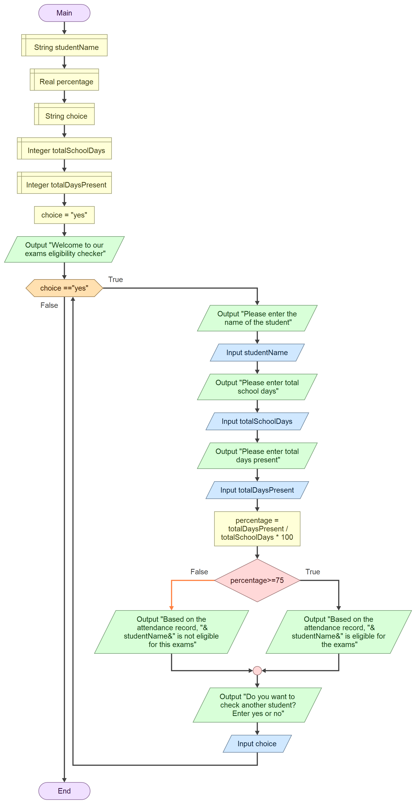

# PROG101 Assignment 1: Exams Eligibility Checker

**Course:** PROG101 Principles of Programming Logic and Design

**Institution:** Limkokwing University of Creative Technology, Sierra Leone

**Student:** Mariama Barrie

**Student ID:** 905006320

**Examiner:** Mr. Laggah

## About the Project

This project is a logical design (no source code) for an **Exams Eligibility Checker**. It helps schools check quickly and fairly whether a student has attended enough school days to sit the examinations.

## The Problem

In many schools, attendance is recorded in paper registers and each student's attendance percentage is worked out by hand. This is slow and mistakes can happen, especially when the examination period is close. Students, teachers, administrators and parents are all affected.

## The Solution

The program welcomes the user, then repeats the steps below while the user answers "yes":

1. Ask for the student's name.
2. Ask for the total school days.
3. Ask for the total days present.
4. Calculate: `percentage = totalDaysPresent / totalSchoolDays * 100`
5. If `percentage >= 75`, show that the student is **eligible** for the exams. Otherwise, show that the student is **not eligible**.
6. Ask whether to check another student.

## Flowchart



## Programming Logic Used

- **Variables and data types:** studentName (String), choice (String), totalSchoolDays (Integer), totalDaysPresent (Integer), percentage (Real)
- **Decision structure:** `percentage >= 75`
- **Repetition structure:** `WHILE choice == "yes"`
- **Boolean logic:** True/False conditions for the loop and the decision
- **Modular design:** Initialisation, Loop Control, Input, Processing, Decision and Output, and Repeat Prompt modules
- **Computational thinking:** decomposition, pattern recognition, abstraction and algorithm design

## Sample Output

```
Welcome to our exams eligibility checker
Please enter the name of the student
Aminata Kamara
Please enter total school days
100
Please enter total days present
90
Based on the attendance record, Aminata Kamara is eligible for the exams
Do you want to check another student? Enter yes or no
no
```

## SDG Alignment

- **SDG 4: Quality Education** (main goal)
- **SDG 16: Peace, Justice and Strong Institutions** (supporting goal)

## Open Source and Digital Public Good

The design is shared openly so that any school, teacher or student can read it, check that the rule is fair, and adapt it (for example, by changing the pass mark). Possible community contributions include translating the messages into local languages, adding input validation, and building offline or mobile versions. By being free, open and simple to run on basic devices, the system could become a Digital Public Good that benefits schools across Sierra Leone.

## Repository Contents

- `README.md`: project overview (this file)
- `pseudocode.md`: pseudocode and step-by-step algorithm
- `flowchart.png`: flowchart drawn with diagrams.net (Draw.io)
- Report file: full written report

## Author

Mariama Barrie (905006320), PROG101, Semester 1 (September 2026 to January 2027)
